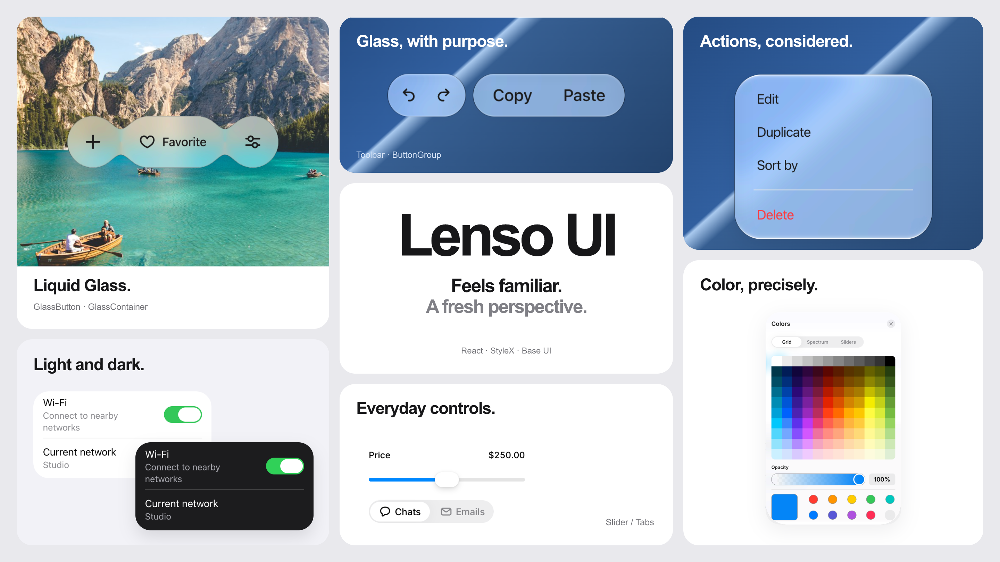

# Lenso UI

[](https://ui.lenso.dev)

**Feels familiar. A fresh perspective.**

React components with an Apple-inspired point of view. Lenso UI brings familiar
controls, purposeful glass materials and light and dark themes to the Web,
built with **StyleX** and **UI SDK**.

[Documentation](https://ui.lenso.dev/en/docs/react/getting-started) ·
[Components](https://ui.lenso.dev/en/docs/react/components) ·
[Photos demo](https://ui.lenso.dev/en/photos)

## Built around the details

- **Familiar interaction.** Buttons, fields, menus and navigation compose UI SDK
  contracts for keyboard input, focus and dismissal. Date, time and color controls
  pair native controls with their specialized value models.
- **Materials with a purpose.** Glass gives floating controls and navigation a
  shared visual language, with refraction, connected surfaces and responsive
  motion. Ordinary form surfaces keep reading and editing clear.
- **A theme that carries through.** Semantic colors connect controls, content and
  overlays across light and dark appearances. Theme scopes carry appearance and
  material settings into portalled components.
- **Parts you can compose.** Use component variants, arrange public parts and
  customize presentation through typed StyleX `xstyle` maps.

## Start building

Follow the [quick start](https://ui.lenso.dev/en/docs/react/getting-started/installation)
to install matching packages, load the theme stylesheet and configure StyleX for
[Vite or Next.js](https://ui.lenso.dev/en/docs/react/getting-started/frameworks).
With that setup in place, render your first component:

```tsx
import "@lenso/tokens/styles.css";
import { Button } from "@lenso/ui";

export function App() {
  return <Button onClick={() => console.log("Saved")}>Save changes</Button>;
}
```

Learn how to [compose component parts](https://ui.lenso.dev/en/docs/react/getting-started/architecture),
[customize styles](https://ui.lenso.dev/en/docs/react/getting-started/stylex)
and [shape a theme](https://ui.lenso.dev/en/docs/react/getting-started/theming).
The component reference includes examples, prop types and callback signatures.

This checkout includes the shared [`@lenso/glass`](packages/glass/README.md)
runtime, which is not yet published. To use this source revision, work from the
workspace or packed artifacts that include it. See [release notes](RELEASE.md)
for package availability and migration details.

## Build with an agent

Two portable skills help coding agents work with Lenso's installed components
and matching documentation:

- [lenso-ui](.agents/skills/lenso-ui/SKILL.md) guides component selection,
  composition, themes, framework setup and debugging.
- [lenso-ui-design](.agents/skills/lenso-ui-design/SKILL.md) guides page layout,
  responsive design and visual review.

See the [agent skills guide](https://ui.lenso.dev/en/docs/react/getting-started/skills)
for installation and example tasks.

## Develop locally

Use the Bun and Node versions pinned in [.mise.toml](.mise.toml), then start the
documentation app from the repository root:

```sh
bun install --frozen-lockfile
bun run dev:docs
```

Open the URL printed by the command. The documentation app includes interactive
examples and reads workspace source directly, with hot reload for component and
style changes. English and Chinese documentation are available at
`/en/docs/react/getting-started` and `/cn/docs/react/getting-started`.

For isolated component stories, run `bun run dev:storybook`. To work on the
independent documentation framework, run `bun run dev:docs-starter`. The two docs
servers default to port 3000; stop one before starting the other.

## Inside the repository

| Package                                     | Role                                  |
| ------------------------------------------- | ------------------------------------- |
| [`@lenso/ui`](packages/ui)                  | React components and composable parts |
| [`@lenso/tokens`](packages/tokens)          | Semantic themes and StyleX maps       |
| [`@lenso/glass`](packages/glass)            | Shared glass rendering and motion     |
| [`@lenso/primitives`](packages/primitives)  | Preserved headless components         |
| [`@lenso/docs`](packages/docs)              | MDX documentation framework           |
| [`create-lenso-docs`](packages/create-docs) | Documentation project initializer     |

[Repository structure](docs/architecture/repository.md) covers the applications,
packages and verification tools in more detail.

## Contributing

Read [DESIGN.md](DESIGN.md) for visual and interaction principles, and
[CONTRIBUTING.md](CONTRIBUTING.md) for development checks and the signed landing
workflow. Keep changes focused and verify the behavior they affect.

Native component semantics are a foundation; applications still own labels,
content, contrast and custom compositions. Check these together in the rendered
interface. Imported reference snippets and automated tests have different
coverage from runnable examples and browser review.

Package publication is separate from source changes. [RELEASE.md](RELEASE.md)
describes the release process and current scope.

## License

Original Lenso work and preserved primitives retain their [MIT terms](LICENSE).
Adapted components retain their applicable licenses. See
[third-party notices](THIRD_PARTY_NOTICES.md) for attribution and license texts.

## Archived experiments

The Exact UI, primitives and documentation experiments were retired on
2026-11-13. Their implementation checkpoint, research and recovery instructions
are preserved in [the Exact archive](docs/archive/exact/README.md).
